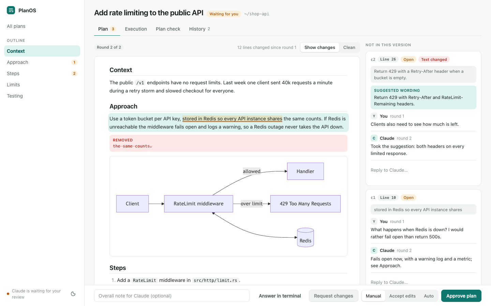
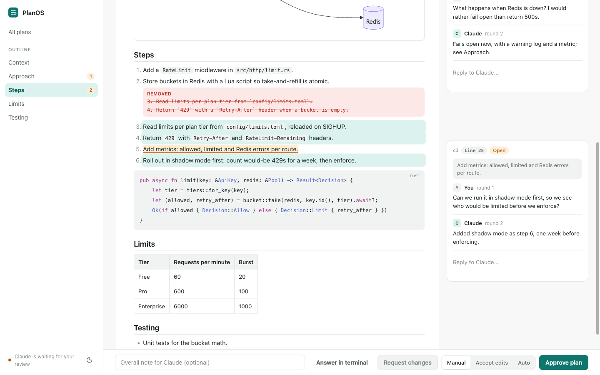
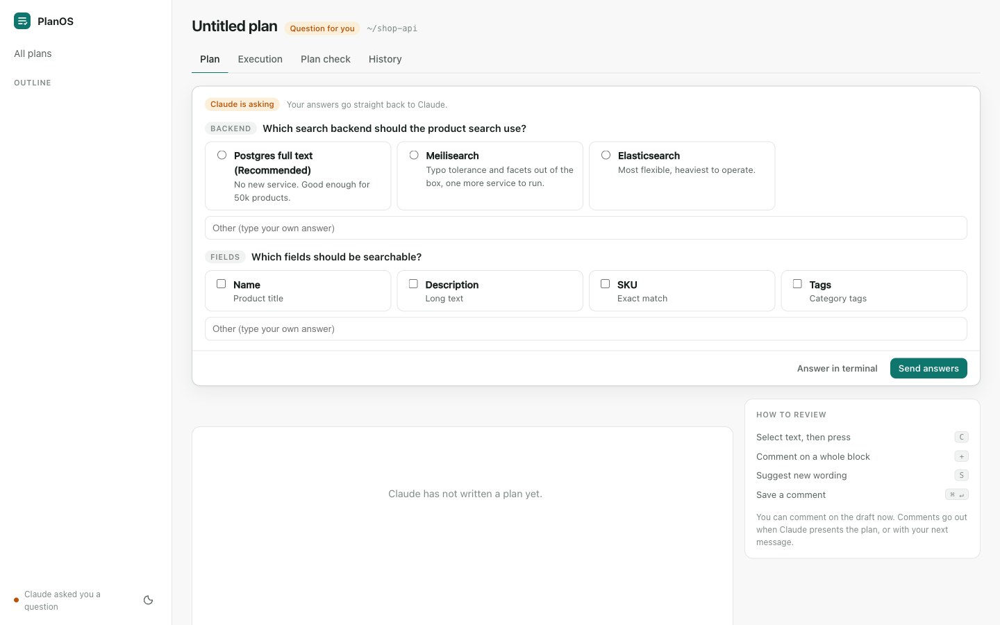
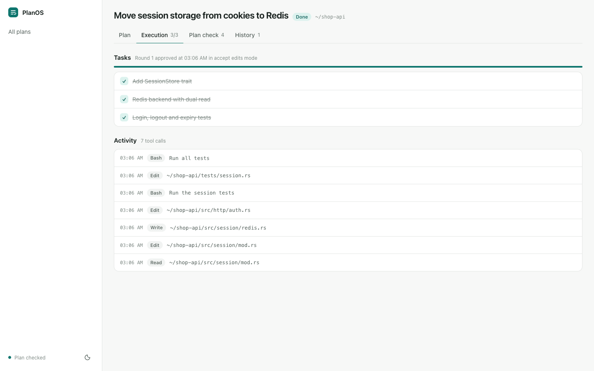
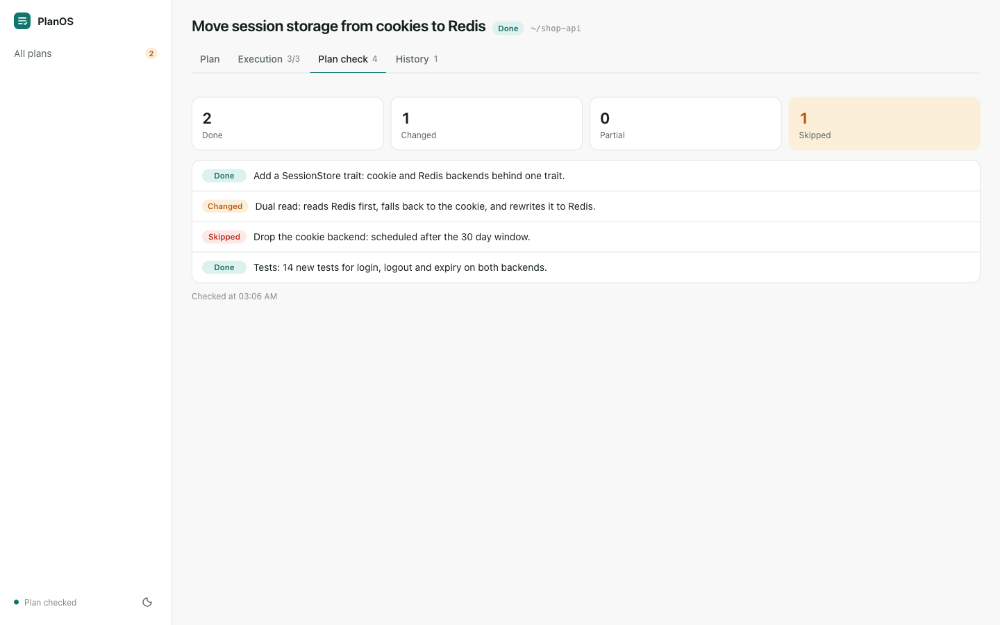
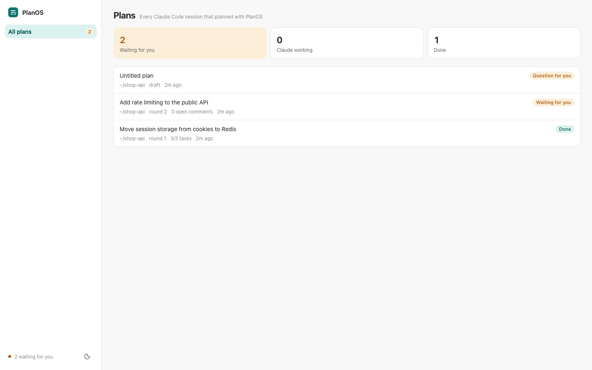

# PlanOS

**Review Claude Code plans like a document, not a terminal scrollback.**

PlanOS opens Claude Code's plan in your browser as a rendered page. Select any
text to comment on it, suggest new wording, answer Claude's questions in a
form, and approve when it is right. Each revision shows what changed and keeps
your comment threads, so you never re-read a long plan to find the one line
that moved. After you approve, the same page follows the work through to a
checked result.



## Why

In the terminal, every revision of a plan arrives as a fresh wall of text.
Feedback means typing "in step 4, change..." and hoping Claude finds the right
spot, and nothing tells you what actually changed between rounds.

PlanOS turns the plan into a shared document, the way you would review a design
doc in Confluence or Google Docs:

- **Comments anchored to text.** Select a phrase, press `C`, write a note.
  Claude gets the exact lines and quote, not a paraphrase.
- **Diffs between rounds.** Changed lines are highlighted and removed text is
  shown inline, so a revision takes seconds to check.
- **Threads with replies.** Claude answers every comment in the next round.
  You resolve the thread or reply again.
- **One place for the whole plan's life.** Questions, review, approval,
  execution and a final plan check, for every session, in one tab.

## Features

| Stage | What you get |
|---|---|
| **Shape** | The plan appears live while Claude writes it. Claude's clarifying questions (`AskUserQuestion`) open as a form with options and free text. |
| **Review** | Comment on a selection (`C`), on a whole block (the `+` in the margin), or suggest new wording (`S`). Each round shows its diff against the previous one. Mermaid diagrams, tables and highlighted code are rendered. |
| **Approve** | Approve and pick the mode Claude works in next: **Manual** (asks before each edit), **Accept edits**, or **Auto**. |
| **Execute** | Claude's task list and every tool call it makes, live. |
| **Verify** | When the work looks finished, Claude writes a plan check: each step marked done, changed, skipped or partial, with a note. |
| **Across sessions** | One page lists every session and what is waiting for you. Every round stays in the history, and nothing is lost on reload. |

### Review threads across rounds

Comments keep their place when the plan changes: PlanOS re-anchors each one by
its quoted text. A comment whose text was rewritten is marked
**Text changed** and kept beside the plan, with the original text and
Claude's reply.



### Clarifying questions



### Execution and plan check





### Every session in one place



## Install

Needs [Rust](https://rustup.rs) 1.85 or newer and
[Claude Code](https://claude.com/claude-code).

**One line, no clone:**

```sh
curl -fsSL https://raw.githubusercontent.com/feryadialoi/planos/main/install.sh | bash
```

**From a clone:**

```sh
git clone https://github.com/feryadialoi/planos && cd planos
./install.sh
```

The script builds `planos` into `~/.cargo/bin`, adds the `planos` marketplace
to Claude Code and installs the `planos@planos` plugin. Run it again to
upgrade.

**By hand**, if you prefer:

```sh
cargo install --locked --git https://github.com/feryadialoi/planos
claude plugin marketplace add feryadialoi/planos
claude plugin install planos@planos
```

Then restart Claude Code, or run `/reload-plugins` in a running session.

**Uninstall:**

```sh
./install.sh --uninstall     # or: curl -fsSL .../install.sh | bash -s -- --uninstall
```

This removes the plugin, the marketplace and the binary. Saved plans stay in
`~/.planos`; delete that folder to remove them too.

## Quick start

1. In Claude Code, enter plan mode with `shift+tab` and ask for a plan.
2. The PlanOS page opens on its own when Claude asks a question or presents
   the plan. Run `planos open` to open it any time.
3. Review:

   | Do this | How |
   |---|---|
   | Comment on a selection | Select text, press `C` |
   | Suggest new wording | Select text, press `S` |
   | Comment on a whole block | Click the `+` in the left margin |
   | Save a comment | `Cmd+Enter` or `Ctrl+Enter` |
   | See what changed | **Show changes** or **Clean** above the plan |
   | Read an earlier round | The **History** tab |

4. Click **Request changes** to send your comments (and an optional overall
   note). Claude revises the plan, answers each comment, and the page shows
   the new round.
5. When the plan is right, pick a mode and click **Approve plan**. Follow the
   work in the **Execution** tab, then read the result in **Plan check**.

Claude Code's own dialogs stay available the whole time: whichever you answer
first, the terminal or the page, wins, and the page catches up. **Answer in
terminal** hands a question or review back to the terminal.

Comments you write while Claude is not waiting for a review are queued and go
out with your next message.

## How it works

```
Claude Code hooks ──> planos hook ──HTTP──> planos serve (127.0.0.1:47820) <── browser
                                                 │
                                                 └── ~/.planos/sessions/<id>.json
```

PlanOS is a Claude Code plugin made of hooks and one Rust binary.
`planos hook` handles every hook call and starts the local service when it is
not running (or restarts it after an upgrade). The service holds the state,
serves the page and waits for your decisions.

| Hook | Used for |
|---|---|
| `PermissionRequest` on `ExitPlanMode` | Review rounds. Approve returns `allow` with the mode to switch to; Request changes returns `deny` with your comments. |
| `PreToolUse` on `AskUserQuestion` (plan mode) | The question form. Your answers go back as the tool's answers. |
| `PostToolUse` (async) | The live draft (writes under `~/.claude/plans/`), the task list and the activity feed. |
| `Stop` | Asks Claude for the plan check once the approved work looks finished. |
| `UserPromptSubmit` | Delivers comments queued while Claude was not waiting for a review. |

When you request changes, Claude receives each comment with its line numbers,
the quoted text and any suggested wording, and is asked to end the revised plan
with a `## Review replies` section, one line per comment. PlanOS attaches each
reply to its thread and hides that section from the rendered plan.

If PlanOS fails for any reason, the hook exits with a non-blocking error and
Claude Code carries on with its own dialog, so a PlanOS problem never blocks
your session.

See [docs/design.md](docs/design.md) for the full design.

## Security and privacy

- Everything stays on your machine. The service listens on `127.0.0.1` only
  and nothing is sent anywhere else.
- Every API call needs the token in `~/.planos/token` (mode `0600`), sent in a
  header. The page gets it through its URL.
- Plans are rendered in Rust with raw HTML escaped, and the page runs under a
  strict Content Security Policy.

## Commands

| Command | What it does |
|---|---|
| `planos open` | Start the service if needed and open the plans page |
| `planos status` | Show whether the service is running, and its version |
| `planos stop` | Stop the service (the next hook starts it again) |
| `planos serve` | Run the service in the foreground |
| `planos hook` | Handle one Claude Code hook call (used by the plugin) |
| `planos --version` | Print the version |

## Configuration

| Setting | Effect |
|---|---|
| `~/.planos/config.json` `{"browser": [...]}` | Command that opens the page, for example Chrome with a profile: `{"browser": ["/Applications/Google Chrome.app/Contents/MacOS/Google Chrome", "--profile-directory=Default"]}` |
| `PLANOS_HOME` | State directory (default `~/.planos`) |
| `PLANOS_PORT` | Service port (default `47820`) |
| `~/.planos/config.json` `{"focus": false}` | Stay put: no desktop notification from the page when Claude asks, and no jump back to the terminal after you decide on the page (both on by default) |
| `~/.planos/config.json` `{"terminal_app": "..."}` | App to bring forward after you decide on the page, when PlanOS can't tell which terminal runs Claude Code (for example `"Cursor"`) |
| `PLANOS_NO_BROWSER=1` | Print the page URL instead of opening a browser, and never move focus |
| `PLANOS_URL_FILE=path` | Also write the page URL to this file |

## Troubleshooting

- **The page does not open.** Run `planos open`. PlanOS opens a browser only
  when no PlanOS tab is already showing that session.
- **The terminal shows `Error: Plan review: ...` after Request changes.** This
  is expected. Claude Code labels every hook denial as an error; Claude still
  reads your comments and revises the plan.
- **Changes do not show after an upgrade.** Restart Claude Code or run
  `/reload-plugins`. The service restarts itself when the binary's version
  changes.
- **Something else.** The service log is `~/.planos/service.log`.

## Develop

```sh
cargo test
cargo clippy --all-targets
```

In debug builds, `rust-embed` reads `ui/` from disk, so page edits show on
reload. Release builds embed `ui/` into the binary. Mermaid is vendored under
`ui/vendor/` (MIT, see `mermaid.LICENSE`).

To try a change against a real session, run `cargo install --path .` and
start a new Claude Code session; `planos stop` makes the next hook start the
new build.
